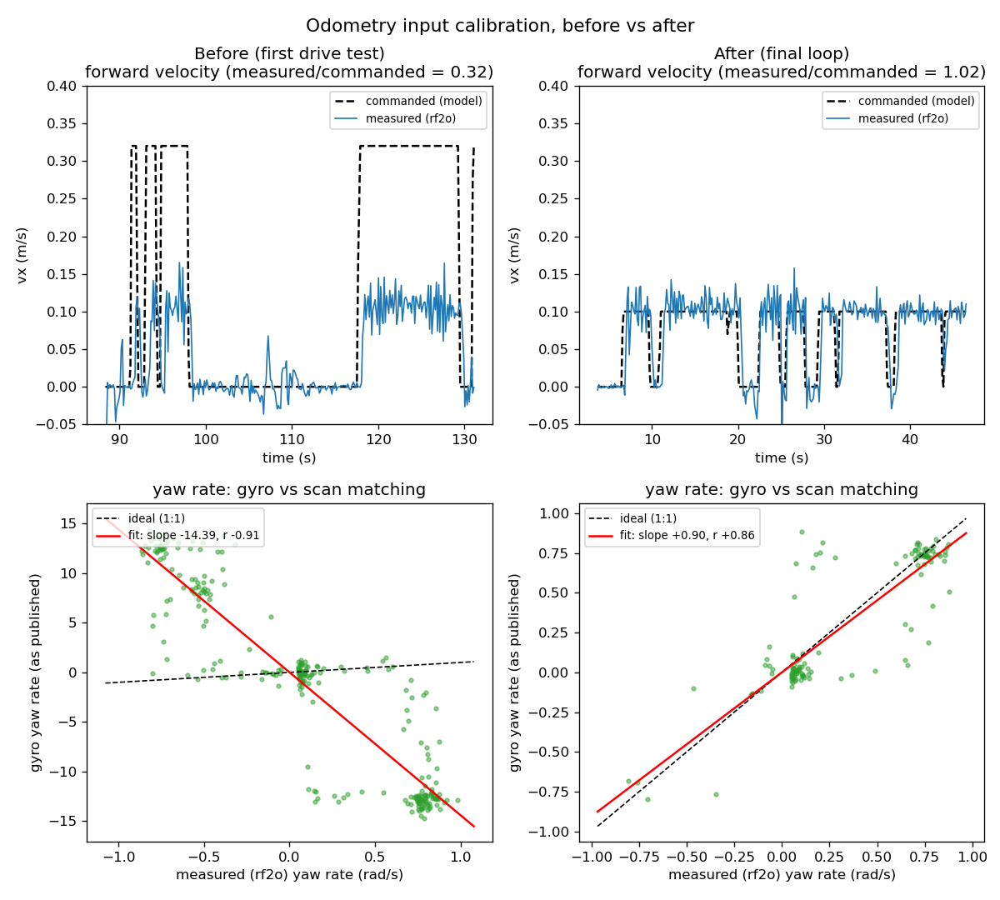

> **Note (2026-11-02):** written for the Humble/Docker workspace. File names map as:
> `launch/robot_start.py` + `perception_oakd.py` → `rover_bringup/launch/robot.launch.py`;
> `launch/localization.py` → `odometry.launch.py` (fused only) + `localization.launch.py`;
> `config/` → `rover_bringup/config/`. The calibration values and results are unchanged.

# Sensor-Fused Localization for an Omnidirectional Rover (ROS 2 Humble)

Lidar scan matching, commanded velocity and gyro rate, fused with an EKF
to give odometry for AMCL map localization. The platform is an
omnidirectional rover with a Jetson, an RPLIDAR A1, an OAK-D Lite and a
flight controller driving the motors over MSP.

This package is one day's work (2026-09-24). It covers the launch
architecture, root-causing why the fused localization was poor, the
calibration tools, and data from each drive test.

---

## Result

| Metric (hand-driven loop, back to a floor mark) | Before | After |
|---|---|---|
| Fused odometry loop-closure gap | 0.92 m | **0.057 m** |
| Fused heading through turns | did not follow turns (replayed: ~4° of a 360° turn) | **within ~3° of scan matching** over a full loop (347° vs 350°) |
| Forward velocity model vs measured (slope) | 0.31 | **0.97** |
| Gyro yaw rate vs measured (slope) | −14.4 (reversed, raw counts) | **+0.91** |

The fused estimate now closes a loop better than either input alone
(scan matching alone: 0.13 m).



*Top: the velocity model predicted 3× the speed the rover actually
moved (left); after recalibration it matches (right). Bottom: the gyro
was reversed and in raw counts (slope −14.4, left); after the fix it
agrees with scan matching (slope +0.90, right). Generated from the
drive-test CSVs by `scripts/plot_calibration.py`.*

---

## System

```
 robot_start.py  (hardware, always up)          localization.py  (on top)
 ┌─────────────────────────────────────┐        ┌──────────────────────────────────┐
 │ rover base ─ /rover/base/odometry ──┼──┐     │  scan filter ─► rf2o ─ /odom_rf2o │
 │   (commanded vx,vy + gyro vyaw)     │  └────►│                    │              │
 │ RPLIDAR A1 ─ /scan ─────────────────┼───────►│  ekf_node ◄────────┘              │
 │ robot_state_publisher (URDF frames) │        │   └► odom -> base_footprint (TF)  │
 │ OAK-D + side cameras, teleop bridge │        │  map_server + AMCL ─► map -> odom │
 └─────────────────────────────────────┘        └──────────────────────────────────┘
```

The EKF (`robot_localization`) takes:

| Input | Fused as | Why |
|---|---|---|
| rf2o scan matching | x, y, yaw, **differential** | measured motion; pose deltas avoid fighting over the origin |
| Commanded velocity | vx, vy | never degenerates (e.g. in a featureless corridor, where scan matching fails) |
| Flight-controller gyro | vyaw | lets the filter *predict* rotation |

---

## Problems found and fixed

Each problem was found from measured data, and each fix was checked by
simulation or on the robot.

### 1. Duplicate publishers across launch files
Several launch files each started their own copy of the lidar driver and
the lidar transform, at different mount offsets (0.2 m vs the measured
0.127 m). Running two of them gave the `laser` frame two parents in the
TF tree, so the lidar appeared to jump ~73 mm and the EKF counted that
as motion.

**Fix:** split into `robot_start.py` (every driver and frame, one owner
each) and `localization.py` (localization only). All frames now come
from one URDF.

### 2. Scan matching silently reversed (upstream rf2o bug)
rf2o reads the lidar's mount transform once, on the first scan. If the
lookup fails, upstream logs one error and carries on with an **identity**
lidar pose. This lidar faces backward (yaw π), so every forward move was
reported as backward. The launch split made the race likely: `/scan` is
already streaming when rf2o starts, so the first scan beats the static
TF into a fresh buffer.

**Fix:** patched rf2o to drop scans until the transform resolves
([patch](patches/rf2o_laser_odometry.patch)).

### 3. Turns thrown away by the outlier gate
Nothing predicted rotation, so every scan-matched rotation update during
a real turn looked like an outlier (Mahalanobis gate 3.0) and was
rejected. I replayed simulated turns through an isolated `ekf_node` on a
separate ROS domain, with no robot involved:

| 90 °/s in-place turn, 360° total | Fused heading |
|---|---|
| Gate 3.0 (original) | ~4° |
| Gate 6 / 10 / 20 | lagged or dropped fast turns |
| Gate removed | 350° |
| Gate 3.0 + gyro fused | 355° |

The same simulation showed that a gate isn't needed against scan-match
glitches during turns: the base's zero-velocity report already keeps a
fake 0.5 m slide out of the fused estimate.

### 4. Gyro reversed and 16× too large
The driver treated raw MSP gyro values as °/s. Regressing gyro rate
against scan-matched yaw rate gave a slope of **−14.4** (r −0.88,
n = 539). The values are raw sensor counts at 16.4 LSB per °/s (the
±2000 dps range), and the flight controller counts yaw clockwise.

**Fix:** `gyro_z_sign = −1`, `gyro_scale = 1/16.4`. Checked on a later
run: the gyro read +0.79 °/s against rf2o's +0.81 °/s during a
straight-line drift.

### 5. Velocity model 3× too optimistic
Commanded velocity is throttle × gain, with no encoders. At teleop
throttle 0.25 the motors are near their deadband, and the rover moved at
**0.33×** the speed the old gain predicted (r 0.94). This was not lag
(the ratio doesn't change when the command is shifted in time) and not
stalls. Strafe was calibrated separately and came out symmetric
left/right.

**Fix:** `k_x` 1.28 → 0.40, `k_y` → 0.30.

### 6. Scale reference checked
Scan matching's own distance scale was checked against a tape measure:
2.305 m measured over a 2.286 m (90 in) run, about 1%.

---

## Tools written

### `scripts/odom_diagnose.py`: drive-test analysis
Passive: it only subscribes, never commands the robot. You drive, press
Ctrl+C, and it reports:
1. **Per-axis regression** of measured velocity (scan matching, rotated
   into the body frame) against commanded velocity. The slope gives the
   gain correction directly; a negative slope means a reversed input.
2. **Path length** of each source, showing whether the EKF follows
   measurement or command.
3. **Heading tracking and gyro sign/scale**, using scan matching as the
   reference (a yaw-π mount doesn't change rotation about z).
4. **Loop closure** for each source, including AMCL in the map frame.

Every run saves a summary and per-scan CSV to `data/odom_diag/`.

### `scripts/rover_teleop.py`: repeatable keyboard teleop
`teleop_twist_keyboard` publishes once per key press, and the base keeps
executing that command until its 2 s watchdog stops it, so the same key
moved the robot a different amount each time. This teleop publishes at
20 Hz and stops 0.6 s after the last key event. Tested: three taps gave
pulses of 0.62–0.64 s, and Ctrl+C always sends a final stop.

---

## Test data (`data/odom_diag/`)

| Run | What | Notes |
|---|---|---|
| `183827` | First loop | Found problems 4 and 5 |
| `185402`, `185507`, `185621` | Straight-line tests | **The base driver was not restarted after a rebuild**: the EKF was fusing the old, reversed gyro. Scan-matching data is still valid; it gave the tape-scale check and the drift measurement |
| `190947` | 90 in out/back + strafing | First fully in-sync run; strafe calibration |
| `192537` | Final loop | The result table above |

A lesson from these runs: before trusting a test, confirm the running
node's parameters match the source (`ros2 param get /rover/base k_x`).

---

## Files

```
launch/        robot_start.py (hardware bringup), localization.py,
               perception_oakd.py (drivers robot_start.py includes)
config/        ekf_fused_odom.yaml, amcl_params.yaml, scan_filter.yaml, rviz config
description/   open_rover.urdf.xacro (measured frames)
src/           rover BaseDriver, rf2o node, side-camera config (full files)
patches/       diffs of the modified packages, and of the launch files over this day
scripts/       odom_diagnose.py, rover_teleop.py, plot_calibration.py
data/          drive-test summaries and per-scan CSVs
figures/       calibration_before_after.png
maps/          RoboPI_DryLab_corridor (the default map localization.py loads)
docker/        Dockerfile, compose.yaml, entrypoint.sh (ROS 2 Humble on Jetson)
```

## Running it

Inside the container, with the workspace built:

```bash
# terminal 1: hardware (base, lidar, cameras, URDF frames)
ros2 launch launch/robot_start.py
# terminal 2: localization (rf2o + EKF + map_server + AMCL)
ros2 launch launch/localization.py map:=RoboPI_DryLab_corridor
# optional: drive and analyse a test run
python3 scripts/rover_teleop.py
python3 scripts/odom_diagnose.py      # Ctrl+C to print the report
```

Set the initial pose in RViz with *2D Pose Estimate*. The launch files
expect the original workspace layout (`launch/`, `config/`, `maps/`,
`description/` side by side); the files here are a curated extract, not
a standalone buildable package.

`patches/rover_BaseDriver.patch` and `patches/rf2o_laser_odometry.patch`
are against the upstream/original sources. They include covariance
changes from the day before (speed-scaled twist covariance and rf2o pose
covariance), which the fusion builds on.

## Known limitations / next steps
- The existing maps were built with the old 0.2 m lidar offset, which
  smears walls by up to ~15 cm depending on heading. Re-mapping is the
  largest remaining gain for AMCL.
- The rover yaws left ~0.9 °/s when driving straight (open-loop motors).
  Localization tracks it; gyro heading-hold in the driver would remove it.
- The velocity gains are calibrated at throttle 0.25; the motor response
  isn't linear near the deadband.
